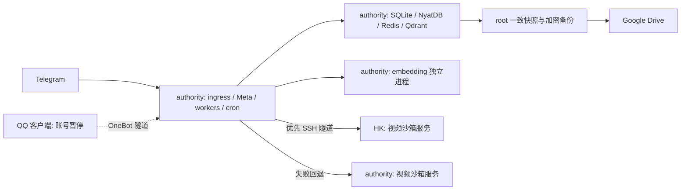

# 当前部署边界与扩容条件

生产版本 2119236 采用一个状态权威、独立 embedding、跨机视频双副本和独立 QQ 客户端。视频优先在香港执行，故障时回退主节点；跨机状态高可用尚未实现。下面区分已实测的边界与后续目标，计算副本不能代替状态高可用。

| 角色 | 本轮放置 | 运行与冗余约束 |
|---|---|---|
| Telegram ingress、Meta、worker、cron | authority 节点，同一 bot 进程 | 共享 SQLite、NyatDB 和发送结算；当前仅一个活动写者 |
| Redis、Qdrant | authority 节点，独立服务 | 仅回环访问；已完成云端隔离恢复，无自动切主 |
| embedding | authority（173）节点，独立用户、端口、进程与资源限额 | 主 bot 已接入回环 3032 的认证 HTTP 服务，local fallback=true；同机兼容与实际停服务回退已验证 |
| 视频抽帧 | HK 主副本、authority 备用副本 | 两个独立服务均回环 3041；authority 通过独立 SSH 转发 3042 访问 HK。主 bot 已启用有界顺序回退，全部失败返回视频占位；不会退回旧的非完整沙箱路径 |
| QQ/NapCat | QQ 节点 | 已有认证隧道；账号暂时封禁，按用户说明暂停登录，等待解封后由操作者恢复 |
| 备份 | authority 节点的 root 控制器 → Google Drive crypt | 首份约 2.5 GB 上传及完整云恢复通过；每日 timer active，05:00 首次自动捕获与05:07上传验证已通过 |
| HK AVX2 embedding 候选 | 安装完成，停用且不进入 embedding endpoint 列表 | 同权重在不同 CPU 上未通过向量兼容验收；不影响该机器的视频服务 |
| TW 小内存 embedding 候选 | 安装完成，停用 | 600 MiB cgroup 冷启动 OOM，不是可用备用 |

同机组合多个角色是受支持的部署方式。独立计算服务不加载 bot 的环境、数据库或平台令牌；它只持有专用计算凭据。模板、固定依赖闭包及协议见 [独立计算运行时](../ops/embedding/README.md) 和 [计算服务契约](embedding-compute.md)。角色配置本身不是分布式租约，不允许将两个包含 SQLite/NyatDB 写者的 bot 实例当成 active-active 副本。

仓库现提供默认关闭的 [日记业务配置](business-runtime-config.md) 和 [单机版本切换控制器](../ops/releases/README.md)。前者保存带审计、可回退的业务设置，后者在旧进程排空且整个 service cgroup 退出后切换已审核的不可变版本；失败时恢复旧代码，不恢复旧数据库。它们需要首次安装和迁移验收，本次代码修改不代表生产已经启用。计算副本滚动更新、主节点跨机接管和状态复制仍不在这个闭环内。

## 已部署的视频双副本

视频服务只接受最多 10 MiB 的已下载字节，不接受 URL、路径、平台凭据或会话 ID。原生解码在独立用户和 user/PID/network 等 namespace 内运行，只挂载固定摘要的解码器、ELF 库与单个只读输入。权限与撤回复核、模型请求、记忆和平台发送留在 authority。两个服务及专用隧道已启用开机启动。

两台机器分别完成真实非 root、NoNewPrivileges 的合成 AVI 抽帧，均产生三张 64×64 PNG，摘要逐张相同。实际停 HK 后，主机客户端改用 authority 副本成功；双副本都停时明确失败、返回零帧，恢复后再测成功。实际 ffmpeg 已执行后取消，两机均有两个 spawn 对应两个 close，没有存活子进程或临时目录残留。未用真实用户附件，未发平台消息，未调用模型。

每个副本默认并发 1，实际安装内存上限 384 MiB、CPU 配额 80%、TasksMax 64。它们是资源上限，不保证所有极端视频都能成功解码。发布后的认证健康检查与上述解码/故障演练分别留证；不得用 healthy 代替实际解码。协议、限制、模板与恢复资产要求见 [视频角色说明](../ops/video/README.md)。

## 为什么暂未把现有向量库切到 AVX2 节点

旧节点为 Xeon L5420，支持 SSE4.1，没有 AVX；候选节点支持 AVX2。两端模型的配置、tokenizer、量化 ONNX 文件，以及 onnxruntime-node 1.14.0 的原生库和 binding 摘要逐项相同。新 local engine 与原路径的 88 个合成输入结果完全一致，说明此次拆分保持了长度前缀、512 字符截断、mean pooling 和 normalize。

四条初始样本的远端最小余弦相似度为 0.9999396626，最大元素差为 0.0017977729，未通过最初的保守门槛。随后先规定检索层验收准则，再使用 64 篇合成文档和 24 条查询，分别比较“新查询对旧向量”和“新查询对新向量”。准则为同输入向量余弦至少 0.999、查询分数差最多 0.003；原 top1 或 top5 边界间距超过 0.006 时不得改变结果，原分数距阈值超过 0.003 时不得改变分类。

候选节点实测最小余弦 0.996313647，最大检索分数差 0.016811748；阈值稳定区发生 2 次分类变化，因此拒绝直接路由。top1 和 top5 成员恰好未变并不能推翻该失败。ONNX Runtime 官方说明不同 CPU 的量化内核可能产生不同的数值行为；它是本次差异的解释候选，尚未逐算子定位根因。参见 [官方量化说明](https://onnxruntime.ai/docs/performance/model-optimizations/quantization.html)。

在 authority 上以独立服务运行同一模型后，88 个输入与原路径逐元素相同。离线客户端的正常请求、首个 endpoint 失败后选择下一个、实际停止服务后走本地 fallback 三种模式均通过。8481c79 发布时主 bot 已切到该回环服务并保留本地 fallback，运行验收通过；HK/TW 不在其路由中。数值证据只覆盖合成样本和这套固定运行资产，不保证任意模型或未来依赖升级都兼容。接口的模型名和维度校验不能代替部署时的权重与数值验收。

下一次外移应选择经过对照的统一计算后端，或创建新 collection、从保留权限的权威来源重新投影并做召回验收；旧 collection 保留回滚。不能混用这两种硬件生成的向量并声称等价，也不能通过不断放宽门槛完成发布。

## 容量与剩余单点

AVX2 候选节点冷启动实测峰值约 677 MiB，稳定驻留约 367 MiB；1 GiB 小节点在 600 MiB 限额下被 OOM，限制 V8 堆后仍失败。因此小节点未列为备用。authority 独立计算服务设置 1200 MiB 内存上限与 100% CPU 配额；它将原生计算与主事件循环隔离，但同机运行并不减少整台机器的总计算量。

当前仍有 authority 主机、SQLite/NyatDB 写权威、单实例 Redis、单实例 Qdrant、QQ 活动登录等单点。Google Drive 是恢复来源，不是即时接管副本。要实现用户目标中的各角色多机冗余，必须继续完成领域状态 API、带 fencing 的 owner 租约、旧 owner 禁止外发、账号入口单消费者以及数据库故障切换演练。详见 [综合执行计划](plans/2026-11-14-integrated-bot-evolution.md)。

首代与首次定时快照包含 24 项文件归档，QQ 隧道身份、平台配置、源码归档、构建和模型权重纳入受限加密备份；SQLite、Redis 和 Qdrant 使用各自快照。QQ 客户端实际冻结约 1.3 秒后恢复，该快照与中心状态不是同一原子时刻。完整云端演练约 9 分 38 秒，没有平台 IO；这不是整机切换 RTO。每日 timer 按上海 04:00 逻辑日检查，首次05:00自动触发和上传已验证，失败不推进成功日。新增视频角色的静态恢复资产另行补入后续快照，不能倒推已存在于早先封存代。详细水位、点数与样本边界见 [恢复证据](backup-recovery.md)。

当前捕获配置已追加视频角色八项归档源，总数为 32；两机静态恢复包与 Node ELF 依赖闭包已在 authority 核验保存。它们进入下一次加密捕获，尚未宣称该新范围已经做过云端整机恢复。
