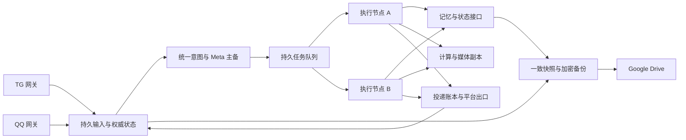

# NyatBot 综合改造执行计划

状态：核心正确性与情绪代码已进入集成检查，独立计算模块及备份正在实施；尚未发布，也未声称整份指南已完成。

## 输入、基线与目标

- 用户提供《NyatBot 架构与长期人格连续性审查》（842 行，审查版本 ad0c17b）；本计划以当前 4a78661475df6047c80132864b6516bb54d901a4 为实际基线，逐项复核，已修复项不重复实施。
- 同时满足用户新增需求：角色可分机部署、每个角色可冗余、同机可运行多个角色、集中管理、每日 Google Drive 重要数据备份，以及更连续自然的情绪表达。
- 用户已授权实施、部署、GitHub 提交和代码审查，并明确不需要业务灰度。测试先在隔离环境完成；上线按依赖分批、保留回滚。默认配置不替其他部署者擅自开启新能力。
- 先修事实和执行契约，再扩容。以有限的粗粒度服务划分承接用户的多机目标，复用现有事件、Agency、BullMQ、来源权限、隔离执行，不引入六套参考项目运行时。
- 本轮经已有代理恢复 SSH，实测 173 上的 Node 单体、Redis、Qdrant 与 QQ 链路均运行，216 上运行 QQ/NapCat。TG 为 hunhebi_bot，QQ 为 2451779635。容量和授权结果见下表；服务存活不等于真实消息端到端成功。
- 上轮测试证据：全量 5,132 通过、31 个与基线一致的环境失败、9 跳过；最终专项 254 通过。新版本重新产生证据，不复用旧绿灯。

## 审计得到的限制

1. [启动装配](../../src/index.ts) 对全部角色启动看门狗，却只在 TG ingress 标记 ready；单独 worker/http/cron 会超时退出。
2. [Attention](../../src/meta/attention.ts) 的本地计时器直接调用 Meta，绕过启动 ownership；只修改角色开关并不能隔离执行责任。
3. [ownership](../../src/startup/ownership.ts) 只是进程配置，未实现跨机器选主。Meta 的进程内 ticking、cron 的进程内 in-flight 都不是分布式租约。
4. SQLite 有大量同步直接调用，QQ 身份分配、来源映射、撤回、执行权和发送结算必须共用权威状态。不能各机器复制一份数据库并同时写。
5. NyatDB 是本地引擎；不能让多个进程或机器直接共享写同一目录。Qdrant 已有网络接口，但初始化写权限、传输和业务权限仍需收口。
6. 模型嵌入、媒体与隔离任务适合先卸载；多个单体同时加载嵌入模型并不会自动降低每台压力。
7. 单机备份、异机副本与可恢复灾备是不同能力。Google Drive 连接器授权不等于服务器定时备份 OAuth 授权。

## 目标模块与放置方式

| 模块 | 职责 | 初始副本策略 | 扩容前置条件 |
|---|---|---|---|
| Control / Meta | 统一身份、注意力、计划、配置和调度 | 一个活动 owner，备用实例 | 持久租约、epoch/fencing、丢租停发、调度记录 |
| Gateway TG / QQ | 平台入站、身份核验、统一发送回执 | 每账号一个活动入口，备用 | durable inbox、按账号 lease、投递去重与 unknown 处理；QQ 登录主备单独验证 |
| Execution workers | 对话生成、研究任务、受控工具 | 多副本队列消费者 | 同任务 claim、版本取消、按会话串行、能力与隐私绑定 |
| Memory / State | 身份与经历权威、投影、召回和权限 | 集中权威写者，备份/备用 | 领域 API；逐域迁移网络数据库，不能远程执行任意 SQL |
| Compute / Media | embedding、语音、图像、文件处理 | 可增加无状态副本 | 认证、资源配额、超时取消、相同模型/维度、文件对象引用 |
| Operations / Backup | 健康、指标、发布、快照、恢复演练 | 一个备份调度 owner，备用 | 独立任务状态、加密凭据、完整清单与恢复证明 |

模块是逻辑角色，不强制一角色一机器。部署清单声明 nodeId、roles、instanceId、资源预算、连接端点和数据目录；单机可组合角色，同一无状态角色可部署到多机。CPU/内存硬限制与队列并发分开配置。不会仅因写了 replicas 就宣称高可用。

数据层的高可用另行验收：两台服务器并不自动形成安全多数派。Redis 异步复制可能丢已确认写；SQLite 备份不是自动主备；Qdrant 副本不是来源权限系统。第一版允许集中权威状态加可恢复备份，明确剩余单点；只有完成故障切换测试后才标 HA。

### 本轮容量实测

采样于 2026-11-14 14:39–14:45 UTC，各列为同一次只读主机盘点的数值，不代表负载峰值。

| 节点 | CPU / RAM | 可用内存 / 磁盘 | 放置依据 |
|---|---|---|---|
| 173.208.241.118 | 8 vCPU，约 15.5 GiB | 约 13.4 GiB / 1.6 TiB | 集中权威状态和控制；老 CPU 缺 SSE4.2/AVX，模型计算优先外移 |
| 45.11.104.108 | 2 vCPU，约 3 GiB，AVX2 | 约 2.5 GiB / 42 GiB | 独立 embedding 主副本候选，需真实模型内存与延迟验证 |
| 45.150.242.74 | 1 vCPU，约 1 GiB，AVX2 | 约 680 MiB / 13 GiB | 计算备用候选；须限额与实际驻留内存验证，不能仅按 CPU 能力分配 |
| 216.236.7.21 | 4 vCPU，约 4 GiB，AVX2 | 约 2.2 GiB / 1.9 GiB | 保留 QQ 客户端；磁盘已用 87%，暂不安装重模型 |

173 的数据库打开者盘点仅发现 nyatbot 与 Qdrant 服务；没有独立日记服务。在线 Qdrant 数据目录必须从普通文件归档排除，改用各 collection 的快照。

## 共同契约

- EventIdentity：平台、账号、会话、线程、原消息、编辑代次；区分 occurredAt、editedAt、receivedAt、processedAt，UTC 毫秒持久化。
- ProvenanceScope：输入来源集合、读取/披露权限、真实/模拟/候选类型；派生记录不能扩大权限，身份不得凭昵称合并。
- ExecutionState：owner、lease、version、cancel generation、阶段结果、wake generation；CAS 禁止取消被完成/重试覆盖。
- DeliveryReceipt：sent / suppressed / failed / unknown，绑定意图版本、目标、实际内容、part index 与平台回执；只有 sent 形成“说过”事实。
- ProjectionCheckpoint：投影版本、事件游标、水位、失败与幂等键；权威正文可重建索引，metadata-only 锚点不冒充完整恢复源。
- BackgroundCheckResult：no_change / state_updated / finding / blocked；后台计算与通知是不同决策，真实通知才消耗发送预算。

## 实施批次与验收

### A：事实、反馈与权限（优先）

- F01：梳理 TG/QQ、streaming、legacy delivery、CodeAct 共用投递结果。禁止负数/抑制结果写进助手历史；部分成功只结算真实目标；unknown 保持未确认且不盲重发。
- F02/F03：反馈保存 actor、target、source 与归因依据；明确回复别人时不回退到 bot；原提问者与评价者分开。稳定事件 ID、事务幂等与学习 outbox 防重复影响。
- F08：兴趣及其他派生自我记录保留来源/披露范围。全局内在变化不等于跨群复述正文。
- F09：旧 terminal 最小环境白名单及必要 clearenv，用假 canary 验证，保留新 CodeAct 隔离。
- F10：候选保存、证据验证、晋升、消费分开；候选不能挤掉有效自我认知。
- F15：关系写前物化衰减，防负反馈反而抬高亲近度；后续长期信任与近期熟悉度分别演进。
- F17：当前开发分支触发 CI；每次 SHA 有 typecheck/lint/build/tests 结果。

验收：同前缀不同内容、A 成功/B 失败、平台超时、反馈错指与重放、派生隐私唯一标记、沙箱 canary、候选晋升、30 天后负反馈。全部使用合成身份和本地替身平台。

### B：耐久输入、执行和恢复

- F04/F05/F06：research 使用统一 claim/cancel/version/step/result；搜索、总结、投递分阶段恢复，重复 wake 只有一个执行 owner。
- F07：mission/open/due/stale 使用完整状态查询或可恢复分页投影；测试超过 500 条历史，不能提高魔数敷衍。
- F11/F12：输入先持久接管再唤醒；消息主体身份与编辑版本分离；QQ 内存 batch 迁移到可恢复 pending intent，失败不能直接删除去重后盲重放。
- F13：源正文和来源先持久化，Qdrant/FTS 投影有重试、游标、失败队列及水位。
- F14：沉默结束改为未验证归档，不作为 achieved。
- F16：重要 cron 有 scheduled/claimed/started/succeeded/failed；失败与完成不共用时间戳。
- 统一可等待取消句柄：停止新增工作、保存取消事实、join 收束；不能声称撤销已经发生的外部效果。

验收：搜索中取消、排队取消、新任务不受旧取消影响；搜索后重启/投递失败只补未完阶段；并发领取、500 条边界、两次编辑、入库后唤醒前崩溃、embedding 停机后补齐。

### C：自然轮次、时间与跟进

- 复用 Attention/Turn Actor 状态，统一 pending intent/lane/revision；同人相关补句合并，无关群聊不延长原人的等待。
- 明确“等我贴完”优先普通截止；到期重评而非发送旧草稿；发送前重检取消、撤回、新版本、已解决状态。
- 四种时间分开；显示时区显式；迟到旧消息不冒充刚刚连续发送；人类节奏估计排除 bot。
- reply/@/跨天跟进绑定原受益人、原消息版本、成果版本和披露范围。相同结果只通知一次，原问题撤回或取消后停止。
- 后台无变化检查零外发；检查资源与通知预算分开。最多一至两条自然气泡是发送计划，未发部分可撤销。

验收：三条补句、两人交错、图片后说明、表情插入、2 秒/20 分钟/3 天、UTC/跨年、断线补投、明确等待、生成中纠正、取消/撤回、三天后正确找人且不重复通知。

### D：情绪、人格与一项持续生活

- 情绪由 prior state + 可归因事件 + elapsed time 更新，有延续和恢复；不由当前群氛围每轮覆盖，不把旁人之间评价当受辱，不从沉默推断对方情绪。
- 内在状态影响接话意愿、语气、注意力、选择与关系，通常不机械报告状态值。去掉工程化汇报、固定服务尾巴与强制口癖；保留角色个性而非统一客服腔。
- 反思引用限定于本次可见证据，支持材料与充分支持分开；反证可修正、降置信度或 supersede，不改写事实。
- 稳定价值、长期信任、近期熟悉度、当前情绪分层；私密经历可以影响她，但正文不扩散。
- 复用 mission/activity/artifact，先跑通一个持续学习/创作项目：动机、练习、作品、失败、反馈、后续选择；真实和模拟经历明确区分。
- 用可控时钟做 30 天离线重放；离线通过不声称已在线生活 30 天。表达质量需样本评审，结构测试不证明“像人”。

验收：情绪跨轮和重启持续但不永久锁死；误归因不改变情绪；失败保持失败，朋友离开不抹去关系；支持/反证改变解释；技术问题仍能准确回答；日常接话不主动念工具名、权限和任务状态。

### E：部署边界与扩容

- 先修角色 ready/ownership 越界，分离 Meta、worker、cron、HTTP、平台 ingress；只有当前角色需要的依赖才初始化。
- 加角色启动清单与能力健康，区分 process alive / ready / active leader / dependency degraded。
- 无状态 embedding/media 服务优先外移；签名/认证、限流、模型维度、批量/并发、取消和一致结果测试。
- 持久执行权与平台发送出口负责 fencing，过期 owner 不能再发；同账号入口只允许一个活动消费者。
- State/Memory/Media 领域边界逐步替代直接本地访问。PostgreSQL 只按经过迁移验证的领域引入，不把同步 SQLite 调用机械改成远程 SQL。
- 部署清单支持同机多角色、各角色多实例、固定版本、独立端口/目录/资源限制。所有连接留在认证私网/隧道，数据库不直接裸露公网。
- 故障演练：kill 活动 owner、网络分区、lease 丢失、重复队列任务、节点重启、错配账号/模型；记录 RTO/RPO 和剩余单点。

### F：每日 Google Drive 备份与恢复

- 备份权威 SQLite/后续数据库、Redis 持久状态、Qdrant 集合快照、启用的 NyatDB、人格/知识/素材、配置与版本清单。密钥和平台会话另作加密受限备份，不写日志或 Git。
- 先建立应用 checkpoint：停止接新工作、排空/持久挂起在飞任务，记录事件与投影水位；SQLite 用 online backup API，NyatDB 在 checkpoint/关闭后取一致副本，不能直接 tar 在线数据目录。
- 快照阶段短暂停写，后续压缩/加密/上传后台执行；大小、空间、耗时和失败状态可见。
- 服务器独立 rclone OAuth + crypt 或等价加密上传 Google Drive。默认每天上海时间 04:00，保留每日 14 份、每周 8 份、每月 12 份；以实际容量核验后固化。未确认上传/校验前不清理旧成功备份。
- manifest 记录版本、schema、集合、模型、事件水位、文件长度与摘要；上传成功不等于恢复成功。首次完整恢复到隔离目录/数据库，验证身份、权限、队列隔离和索引水位；以后定期校验。
- 恢复默认禁止平台 ingress/egress，pending 外部副作用先核对 unknown，避免恢复后群发旧消息。
- Google Drive 未授权/目标目录未确定时只完成本地工具与验证，不伪造云端成功；准备可审查配置后再请求必要登录信息。

### G：收敛旧路径与独立 Code Review

- 为每条遗留路径建立使用证据与替代映射；功能等价、故障测试通过后才删，不以减少文件数为目标。
- 每批交给非作者审查：调用链是否真接入、隐私范围、幂等/取消、并发、备份与恢复、副作用是否有回执。所有 P1/P2 逐项解决或明确记录阻断原因。
- 根任务统一 typecheck、lint、census、build、deploy verification、相关集成、全量单测；新失败必须定位，不用历史 baseline 掩盖。
- 发布前保存可回滚源代码、环境与数据快照；版本和部署源/构建摘要一致；校验当前进程 TG/QQ、Meta、队列、索引、定时备份。真实媒体/自然度/长周期观察未验证要直说。

## 当前任务台账

| 工作包 | 状态 | 完成证据 |
|---|---|---|
| 指南全文读取、对照当前版本 | 已完成初读 | 842 行，F01–F17 与补充章节已映射到本计划 |
| 运行/数据/备份边界审计 | 已完成初审，继续集成复核 | 107 个直接 SQLite 导入文件；统一写权威与来源权限边界已明确 |
| 容量与网络复测 | 已完成 | 四台真实 SSH 盘点；容量见上表 |
| A–B 正确性与耐久链路 | 已实现主要修复，待全量集成/发布 | F01 投递 125 项、F13 记忆 191 项专项通过；入口、研究、反馈、cron 有独立回归 |
| C 自然轮次与跟进 | 统一意图和后台发布已实现，待中央发布 | C 19 文件 221 项；含后台发布综合 24 文件 278 项，最后补测 84 项；实际来源、零更新静默与未知回执限制见专项文档 |
| D 人格与情绪 | 结构回归、真实有界创作样本已通过，待发布 | 情绪持续与账号隔离回归；30 天离线重放；真实 Linux guest 保存并核验一份数字作品、零平台外发；自然度仍需长期观察 |
| E 多机模块与冗余 | 计算边界已独立，异构主机暂不切换 | authority 独立服务 88 样本逐元素一致及实际停止回退通过；AVX2 候选未通过检索阈值兼容，小内存候选 OOM，均不冒充可用备用；状态仍单权威 |
| F Drive 备份 | 授权及加密连接验证通过，正式快照待执行 | drive.file OAuth、cryptcheck、加密往返摘要一致；尚无正式生产备份或恢复成功声明 |
| G 总审查、发布与回归 | 待实施 | 当前 SHA 的验证记录 |

每个工作包更新本表及相应测试证据。未完成项保持未完成；不会把计划、模块存在、单元测试通过或存活健康检查当成端到端上线证明。

当前代码审查发现、表达采样边界见 [独立审查记录](../evolution-code-review.md)；节点角色、计算兼容性与剩余单点见 [部署边界](../deployment-topology.md)。
